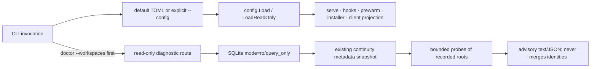

# Architecture

Mnemos is a layered Go service with strict boundaries. This document walks the layers from the bottom up.

中文说明与 Mermaid 架构图见 [Mnemos Memory 架构说明](ARCHITECTURE.zh-CN.md)。

## Principles

- **Interfaces declared where they're consumed.** `memory.Reader/Writer/Maintenance/Exportable/Vectorable` live in the memory package because services depend on them; the `storage` package implicitly satisfies them. This is the stdlib `io.Reader` idiom — segregated, composable, easy to mock.
- **Transports are thin adapters.** `internal/mcp` wraps the official Model Context Protocol Go SDK; `internal/api` is a stdlib `net/http` adapter. Neither contains business logic.
- **No global state. No `init()` side effects. No reflection wiring.** All dependencies are constructor-injected.
- **Errors wrapped at every boundary** with `fmt.Errorf("context: %w", err)`. Nothing escapes naked.
- **Context propagation.** Every public method takes `context.Context` first.
- **Tests live next to code.** Table-driven where patterns repeat; end-to-end at each layer's public API.
- **Don't reinvent the wheel.** We use the official MCP SDK (protocol compliance + schema inference), `gopkg.in/yaml.v3` (robust YAML for vault frontmatter), `golang.org/x/sync/errgroup` (clean daemon lifecycle), `BurntSushi/toml` (config), `modernc.org/sqlite` (pure-Go driver), `oklog/ulid/v2` (sortable IDs). Everything else is stdlib.

## Layer map

```
┌──────────────────────────────────────────────────────────┐
│  cmd/mnemos                (CLI: serve, init, doctor, …) │
├──────────────────────────────────────────────────────────┤
│  internal/mcp              (JSON-RPC stdio server)       │
│  internal/api              (HTTP API)                    │
├──────────────────────────────────────────────────────────┤
│  internal/prewarm          (push-based context assembly) │
│  internal/continuityflow   (start + progress composition)│
│  internal/continuity       (workspace progress protocol) │
│  internal/safety           (promptware scanner)          │
│  internal/dream            (consolidation + promotion)   │
├──────────────────────────────────────────────────────────┤
│  internal/memory           (Observation service)         │
│  internal/session          (Session service)             │
│  internal/skills           (Skill service)               │
├──────────────────────────────────────────────────────────┤
│  internal/storage          (SQLite + FTS5, migrations)   │
└──────────────────────────────────────────────────────────┘
```

## Runtime configuration and workspace diagnosis

The CLI carries an explicit configuration selector in the command context. It has no process-wide override: the standard file is `~/.mnemos/config.toml`, and `mnemos --config <file> <command>` selects another file. Relative storage, vault and client paths resolve from the selected TOML file's directory. Normal first use may create the standard file; read-only projection and `doctor --workspaces` use built-in defaults only when that implicit file is absent. A missing explicit file is an error.



Workspace identity is not a global configuration value. Non-Git projects provide `workspace_root` for the current explicit continuity invocation; Git worktree roots use existing canonicalization. `doctor --workspaces` only compares recorded bindings and bounded path metadata. It skips the mutating setup used by ordinary doctor, never migrates SQLite, crawls source trees, reads private checkpoint bodies or registers roots. WAL diagnostics require pre-existing readable `-wal` and `-shm` sidecars so committed rows are visible; SQLite may update reader marks in the existing SHM file. See [workspace diagnostics](WORKSPACE_DIAGNOSTICS.md) and [configuration](CONFIGURATION.md) for the user-facing limits.

## Storage

`modernc.org/sqlite` (pure Go, no CGO). One file at `~/.mnemos/mnemos.db`. WAL mode, foreign keys on, 5s busy timeout. Schema versioned via `schema_migrations` + numbered SQL files embedded via `//go:embed`.

Every migration rechecks its version after acquiring the immediate writer
transaction, before reconciliation or DDL. Independent processes therefore skip
an upgrade another writer has just committed; DDL and the version marker still
roll back together on failure. The initial version cache is only a fast path.
Creating the migration ledger also uses a writer transaction. Fresh connection
initialization can independently encounter SQLite's WAL-mode lock; only that
Ping phase retries typed `SQLITE_BUSY` errors within a bounded startup window.
Other errors, migrations and business writes are not retried by that mechanism.
Cancellation stops further attempts; an in-flight driver open still obeys the
driver's own busy timeout rather than a strict application wall-clock deadline.

Migration 0010 restricts observation/skill FTS update triggers to indexed columns
whose values actually changed. Access counters, effectiveness, lifecycle, trust
and export metadata do not rebuild text indexes. Insert/delete and actual indexed
text changes retain transactional index maintenance; older migrations are intact.

Key design calls:

- **Bi-temporal**. Observations carry `valid_from`/`valid_until` (fact time) and `created_at`/`invalidated_at` (system time). Supersession invalidates rather than deletes. Historical queries work via `SearchInput.AsOf`.
- **FTS5 external-content virtual table** mirrors observations for BM25 search. Triggers keep it in sync on insert/update/delete.
- **Content hash on insert** powers dedup-on-save: identical content in the same `(agent, project)` bumps access count instead of duplicating.
- **Embeddings as BLOB**. Cosine similarity runs in pure Go over scoped embedded rows. Cost scales with corpus size and dimensions; see `docs/EMBEDDINGS.md`. No additional vector index or CGO dependency is introduced.

## Memory service

**Score contract** (specs: `memory-retrieval`, `memory-lifecycle-retrieval`). Every search result's `Score` is

```
Score = clamp(relevance × policy × graph_factor × contradiction_factor, (0, 1.2])

relevance = weighted mean of per-source [0,1] relevance over available signals
            n_bm25 = b / (b + 8)                     # saturating; b = raw BM25 magnitude
            n_cos  = clip((cos − 0.2) / 0.6, 0, 1)   # calibrated similarity window
policy    = importance_weight × recency_factor × access_factor × cross_project_penalty

importance_weight     = 0.5 + 0.5 × (importance / 10)   # 0.55..1.0
recency_factor        = (1 + age_days)^(-decay_rate)    # exactly 1.0 when pinned
access_factor         = 1 + 0.1 × ln(1 + access_count)  # ACT-R base-level activation
cross_project_penalty = 0.05                            # other-project hits (PreferProject)

graph_factor          = 1.0 for primary hits; 0.70 for 1-hop neighbours (refines/derived_from)
contradiction_factor  = 1.0 clean; 0.50 if curated/skill contradicts; 0.75 if raw-only refutes
```

**Type-differentiated decay and pinned lifecycle.** Rather than a single flat decay slope, `decay_rate` reflects cognitive multi-sector persistence:
- `convention`, `architecture`, `decision`: `0.002` (year-scale half-life; core architectural facts do not rot)
- `pattern`, `preference`, `semantic`: `0.030` (slow decay)
- `bugfix`, `context`, `episodic`, `dream`: `0.050` (standard default)
- `correction`: `0.100` (accelerated fade unless reinforced or promoted)

**Pinned core memory (`pinned = true`):**
- Recency factor is held at `1.0` (zero time decay regardless of type or age).
- Exempt from idle-importance decay in the dream pass (`DecayImportance AND pinned = 0`).
- Pinning clears `expires_at` so core memories cannot silently be pruned by TTL.
- Guaranteed Tier-0 slot at the top of every prewarm block (up to 150 tokens).
- Does *not* bypass trust-tier quarantine (`raw` pinned notes stay quarantined).

**Expansion stays inside the query's contract.** A graph neighbour is never a
back door past the search filters: expanded neighbours pass the same raw-tier
quarantine and type/project/agent/importance/tag constraints as primary hits,
and they never override their parent's score.

The scale is identical in keyword-only and hybrid retrieval — that is the
contract's whole point: a consumer threshold (the prompt hook's floor) means
the same thing in every mode, and a weak result set scores low even for its
top hit. Recall runs keyword (FTS5 BM25) **unioned with** vector cosine over
every embedded row in scope before ranking, so a memory sharing no keywords
with the query is retrievable at all. A missing embedding is renormalised
away when keyword weight is nonzero; zero-relevance hits are dropped. `retrieval_mode`
reports which sources contributed and never changes what `Score` means.

**Calibration basis.** The gate floor (`promptMemoryMinScore = 0.10`, used by
the per-prompt and pre-tool hooks) and the cross-project penalty came from
the deterministic sweep (`mnemos verify calibrate`) over the seeded
calibration corpus, corroborated by translating the old empirically tuned
BM25-scale floor (1.5) onto the contract scale (~0.15). The sweep is pure
and deterministic; re-run `mnemos verify calibrate [fixture]` against a live
corpus to retune. Each result carries its breakdown (`Relevance`,
`PolicyFactor`, raw `BM25`) so "why did this pass the gate" is answerable
per hit.

`Save` returns a `SaveResult` indicating fresh insert vs dedup. Search pulls `limit × 3` raw hits per source, re-ranks, truncates to `limit`. Default filters to live-now; `IncludeStale` and `AsOf` opt into historical queries.

CLI and server paths share a small memory configuration factory: complete default
rank/hybrid parameters are initialized, then configured decay and alpha override
them, including an explicit alpha zero. Provider discovery remains at the existing
embedding-aware call sites; continuity-only operations do not trigger it.

Application settings come from `~/.mnemos/config.toml` or the explicit
`mnemos --config <file> <command>` selector. The selector travels in the command
context, so concurrent operations do not share a mutable process-wide config
value. Relative storage, vault and client paths are anchored to the selected file.
The pi package uses its `mcp.json` as the shared absolute executable/config route
for MCP and hooks; its client projection returns switches only and does not open
SQLite or initialize embedding.

Vector-only recall and fusion use the same model/dimension/signal compatibility
check. An incompatible stored vector is an absent source, preserving keyword
scoring when its configured weight is nonzero rather than fabricating similarity
zero. A usable query honors alpha zero's pure semantic weighting; an unusable
query vector falls back globally to keywords. Existing model and BLOB metadata
are sufficient; rebuilding is an explicit maintenance operation. See
[EMBEDDINGS.md](EMBEDDINGS.md) for cursor, failure and concurrency semantics.

## Traceable memory evolution

Optional `topic_key` is a trimmed, case-sensitive UTF-8 key of at most 256 bytes, scoped by the existing agent/project fields. A rule and its exception can share a topic and remain simultaneously live; topic equality never implies replacement. Search accepts an exact topic filter across keyword recall, vector recall, and graph expansion. The non-unique topic index is an acceleration structure, not a topic entity or cached truth.

`Save` with `replaces_id` names an expected live version. Under one SQLite writer reservation it rechecks scope, trust, topic, and pin policy, inserts the explicit new version and its evidence, writes the supersession edge, and invalidates the old version. Any failure rolls all of these back. Existing-version `Link(..., supersedes)` uses the same atomic lifecycle boundary, rejecting self/cycles, cross-scope links, future-effective replacements, and a second different successor. Raw content cannot invalidate curated/skill content. A pinned target yields a pinned, non-expiring successor unless `unpin_replacement` explicitly permits dropping the inherited pin. An omitted topic inherits the target's; an explicit different topic conflicts. New versions receive only explicitly supplied evidence.

The supersession edge stores an optional SHA-256 `replacement_hash` of the original normalized request. It includes stable requested lifecycle options (TTL days, explicit UTC validity, pin/unpin), resolved scope, content identity, and sorted canonical evidence identities. It excludes generated timestamps, current mutable pin/trust, and latest check markers. This minimal durable retry identity is necessary because later supersession changes validity and later operations can change pin/trust. Replay checks the stored identity before target liveness: the same request returns the original successor, including after further evolution; a different payload yields `ErrConflict`. There is no operation ledger or generation-counter table. Legacy content hashes and dream's `promoted-origin:<12-char hash>` remain unchanged.

At most 16 evidence references belong to each observation version in `observation_evidence`, keyed by the SHA-256 of locator, relation, revision, selector, and fingerprint. Locators are at most 2048 bytes, revisions 256, selectors 512; an optional fingerprint is 64 hexadecimal SHA-256 characters. Duplicate identities collapse to one reference. Topic and reference writes scan both original and sanitised text for high-risk patterns. Non-user provenance still clamps the observation to raw. No locator is dereferenced, opened, executed, indexed as a fact, or embedded. Reference counts measure distinct references, not independent proof or confidence.

New references start `unverified`. Explicit `CheckEvidence` writes only the latest caller-reported `unverified`, `matched`, `changed`, or `unavailable` status and service-clock timestamp; `matched` requires a fingerprint baseline. These markers never change trust, validity, importance, pinning, popularity, or ranking and do not certify a claim. Historical owners retain their evidence; physical deletion/pruning cascades to the owned rows. There is no source-document store, source-body capture, check-history table, or automatic source poller. A fingerprint cannot reconstruct unavailable source material.

All observation read paths use a scalar evidence projection within their existing SQL query, avoiding nested pool reads while single-connection cursors are active. A malformed new metadata payload fails reading/export rather than silently becoming an empty evidence set. Metadata-aware saves resolve deduplication inside the write transaction: identical scoped content/topic/evidence reuses a live version, while different topics/references preserve separate versions. Check-state changes do not affect identity; absent-metadata saves cannot accidentally reuse metadata-bearing rows.

Full-store schema-version-2 snapshots preserve topics, version-owned evidence/latest checks, and historical supersession endpoints, edge timestamps, and request hashes. Owners/evidence/links export from a coherent read snapshot without access increments. Import preflights identities/orphans and restores all observation owners, then references, then links in one transaction. Matching IDs skip without overwriting newer local operational state; a non-empty imported evidence set must match the stored version identity. Old metadata-free dumps can still skip matching owners without deleting new metadata. Vault and skill packs remain narrower/lossy formats for evidence. Keep an upgraded database or new-version fidelity backup before downgrade: older tools can omit the new fields and cannot preserve them through export/import. See [BACKUP.md](BACKUP.md).

## Progressive scoped reading

`memory.Service.GetMany` and `Neighborhood` add ordinary scoped navigation alongside existing search and administrative single-ID get/replay. Both require an explicit non-empty project and resolve an omitted agent to `default`, matching save. Scope remains hard even with raw or historical options. By default, observations must be non-raw and fact-valid at the effective time: `valid_from <= AsOf`, with invalidation, valid-until, and expiry after that time. Omitted `AsOf` uses the service clock; explicit `IncludeStale` bypasses temporal predicates. Historical validity does not impose `created_at <= AsOf` or reconstruct a historical snapshot of mutable fields. Existing Search/Get/replay semantics stay unchanged.

A batch accepts 1–32 requested IDs, deduplicates in first-requested order, and returns `ok`, `unavailable` (missing and filtered are indistinguishable), or `omitted_for_size`. An `ok` detail is complete except that embedding vectors and model names are excluded. Size-omitted and unavailable results contain only the requested ID/status, with no title, content, scope, or omission reason for filtered records.

The response budget defaults to 32 KiB and has a 256 KiB maximum. `bytes_returned` is the sum of the JSON-encoded complete detail/summary objects, including metadata and JSON escaping. This bounds large titles, tags, rationale, and structured fields as well as content; it excludes the fixed/count-bounded status envelope. IDs must be valid UTF-8 and at most 256 bytes, projects at most 4096 bytes, and agent IDs at most 256 bytes. An oversized stored neighbourhood ID fails the request rather than leaking an unbounded ID outside the budget. Items are never partially truncated to force a detail to fit.

A neighbourhood validates its anchor and reads one coherent SQLite transaction snapshot. It applies scope/trust/time filters before selecting 0–10 visible neighbours on either side, ordered by `(created_at, id)`. Omitted before/after limits default to 3; explicit zero selects none on that side and can still report more eligible neighbours. The window metadata counts visible window members before size omission, not hidden rows. A hidden anchor returns one unavailable status and no window counts. A visible anchor without a session returns just its summary and `no_session: true`. Summaries include original visibility metadata and explicitly flagged, UTF-8-safe title/snippet shortening (256/512 bytes); they do not include full bodies.

Non-mutating scoped reads fully drain their cursors before a single atomic access update. Only unique `ok` batch details increment existing counters; a bookkeeping error fails the complete detail request and rolls back partial updates. Summary browsing and size-omitted/filtered items do not increment access. A counter measures a service read, not confirmed delivery, successful use, or an outcome. Neither operation creates injection events. Batch selections, windows, snippets, budgets, and status objects remain transient; no migration, cursor table, read-event table, remembered copy, or automatic source-URL/path fetch is introduced.

## Shared session continuity

`internal/continuity` owns a separate, opt-in progress path. Its workspace identity is a versioned hash of the canonical local worktree root, independent of the legacy `project` label. Subdirectories share their worktree identity; same-named clones and linked worktrees do not. Non-Git workspaces require an explicit existing root. Repository selection ignores Git environment overrides and validates that the resolved root contains the calling directory. Branch and HEAD are sampled context, never workspace identity. Moving a checkout does not silently merge its old continuity state.

Two narrow tables attach this state to existing sessions: `session_continuity_bindings` records the exact owner, workspace, harness and startup retry identity; `session_checkpoints` retains one latest structured body per session. The session owner (`AgentID`, default `default`) is distinct from the harness and native host-session ID. A stable start key confirms the same still-open session; a new invocation key creates an independent session. Session creation and binding commit atomically. Legacy heuristic adoption, host-ID matching, twin closure and stale sweeps exclude bound sessions in the new binary; ordinary administrative lists still include them. Existing observations and historical project labels are not rewritten, and unbound legacy sessions cannot become continuity candidates merely because their project name matches. All processes sharing the database must use a continuity-capable binary before enabling this path.

A checkpoint is agent-authored progress, not long-term knowledge. Its task, reported active/blocked/done state, summary, next steps, blockers and locators are explicitly bounded; canonical payload size is at most 16 KiB, with raw requests at most 32 KiB. References are never fetched or executed. There is no transcript capture, embedding initialization, skill promotion, automatic observation creation or inference that reported work succeeded. Visibility defaults to owner; explicit workspace publication shares this body and bounded provenance, not the source session's goal, reflection, other private records, or authority to read its private observations.

Updates replace the entire latest body using an expected revision and request ID. A matching current retry confirms the original committed revision and timestamp without resampling branch/HEAD. Conflicting or obsolete requests cannot overwrite newer work. Clear retains a body-free revision marker and current retry identity, preventing old requests from resurrecting cleared text; clear does not cause the session's final summary to reappear as a fallback. Closing a session rejects new checkpoint bodies while permitting the current exact retry and owner clear. There is no checkpoint history or automatic TTL deletion, and clear does not erase previous backups or guarantee physical erasure from SQLite WAL. Logical export/import retains its legacy scope and reports omitted continuity state; consistent same-machine SQLite backup is the complete continuity backup path.

Recovery is a read, with no claim or ownership transfer. Candidate visibility, counts, revision and body come from one SQLite read snapshot. The service samples the current branch/HEAD at the bound root for each request. Explicit source IDs must be visible in that workspace or return unavailable without substitution. Otherwise candidates exclude the receiver and optionally match the exact task label. Automatic selection requires resume intent and exactly one candidate across the complete visible, task-filtered set, before pagination or byte limits; that source must also be a fresh active/blocked checkpoint with matching known branch and HEAD. A second stale, done, different-branch or summary source still prevents implicit selection. Candidates sort by recorded time descending, then session ID. Two concurrent tasks therefore yield an ambiguous offer; an explicit source ID selects the intended one without consuming it. A single matching checkpoint with resume intent may be selected, but execution still requires checking current files, diffs and relevant tests. An ended session and a reported done task are separate facts.

Only same-owner, bound, ended sessions lacking any checkpoint marker can contribute a bounded final-summary candidate. Cross-owner recovery sees only explicitly workspace-shared checkpoints. Legacy Get/replay are not used to expand references or compose shared progress. The selected result is passed to prewarm as request-local data; all candidates, size calculations, rendering and `continuity_refs` are transient. See [the context protocol](CONTEXT_PROTOCOL.md) for the exact composition and provenance boundary.

Candidate reads stream metadata for the full visible, task-filtered set and retain
a fixed top-K window ordered by actual timestamps and session ID. After draining
that cursor, the same read transaction loads only the window's complete bodies;
legacy summaries use bounded prefixes. Full matched counts preserve ambiguity
even when another stale/done source lies outside the display window. Body memory
scales with the requested window, while metadata scan CPU still scales with
history. This does not delete old progress, add a candidate cache, or change v1
wire fields and response byte budgets.

## Pre-warm

The big one. Agents don't self-invoke memory tools reliably, so `mnemos_session_start` doesn't hand back just an ID — it returns a pre-warmed block assembled from:

1. **Conventions** for the project (title + one-line rationale)
2. **Recent sessions** (3 most recent, summarised)
3. **Matching skills** (top 3 by FTS relevance on `goal`)
4. **Corrections** (top 3 on `goal` or `project`)
5. **Hot files** (top 5 by touch count for the project)

Each section is scanned by `safety.Scanner`. High-risk content gets a visible `[MNEMOS: FLAGGED]` banner; low-risk content is sanitised (zero-width + control chars stripped). The whole block is token-budgeted to ~500 tokens (curate aggressively; bloated context hurts more than no context).

Delivery selects complete independently rendered items in pipeline order. A full item is tried first, then a complete title with its type/ID, then a minimal type/ID. Assertions are never byte-truncated. Mandatory contradiction and safety annotations stay attached even to compact items; an item is omitted if those annotations cannot fit. Full candidate sections and sanitised selected sections are scanned, including patterns spanning items. Different IDs, including a rule and its exception, remain distinct. A repeated `(kind, ID)` is emitted only at its first selected occurrence.

Prewarm and explicit `memory.Context` use the same `ceil(UTF-8 bytes / 4)` estimate over final output, including headings, separators, warnings, and pinned overflow notices. This is an estimate, not a model token limit. Pinned items keep their Tier-0 priority and 150-token allocation with a complete shown/available notice when needed. Budgets too small for an entire notice can yield an empty block.

Returned section bodies, selected references, and the existing injection log describe the same emitted items. Recording remains best-effort: failure does not prevent context delivery. An injection event means the service emitted an item; it does not prove the host displayed it, the agent attended to it, or the task succeeded. Historical over-recording cannot be reconstructed and is not backfilled.

Candidate sets, render items, compact snippets, deduplication sets, estimates, and final bodies live only for the request/response. They are never stored as observations, cached in new tables, or copied into injection events. Existing minimal injection rows retain only reference, channel, scope, and time under the existing retention policy. Evaluation labels stay in versioned fixtures; reports go to CLI output or an explicitly requested file.

Compaction-recovery mode reuses the pipeline but prioritises the current session's state: goal + in-session observations come before conventions.

## Skills

Procedural memory. `(agent_id, name)` is unique; saving the same name again bumps `version` instead of duplicating. `effectiveness` is `success_count / use_count`, nudges ranking. No LLM calls from inside the memory layer.

Skills arrive two ways. The primary path is agent-authored: the agent calls `mnemos_skill_save` and we store + rank. The secondary path is pattern-mined: the dream pass (see below) clusters correction observations and promotes them into skills when a cluster crosses a threshold. Promotion is pure string assembly over the structured correction records, so the "no LLM in the memory layer" invariant holds in both paths.

## Dream consolidation

`internal/dream` runs the sleep-time-compute pass, either one-shot (`mnemos dream`) or as a daemon (`mnemos dream --watch`). Each pass produces a `Journal` mirrored into memory as a `TypeDream` observation so the agent can query its own history via normal search.

Pipeline, in order:

1. **Prune** expired observations (`valid_until` passed or `expires_at` reached).
2. **Decay** importance on rows idle past `StaleDays`.
3. **Promote** skills from correction clusters. When three or more live corrections share an `(agent_id, project, label)` key — label = first tag, falling back to a normalised title prefix — the pass synthesises a skill with `## When this applies / ## Avoid / ## Do` sections. Idempotency is keyed on a 12-char sha256 of the group, carried as a `promoted-origin:<hash>` tag on the resulting skill. Repeat passes either no-op (nothing new) or version-bump (new corrections joined the group).
4. **Journal** — write the counts as a dream observation if any step changed state.

`dream.Config` takes the `memory.Reader` + `*skills.Service` for step 3; when either is nil the step silently skips so existing callers that predate promotion still work.

## MCP

We use the [official Model Context Protocol Go SDK](https://github.com/modelcontextprotocol/go-sdk) (v1.8.0). Each tool is registered via `mcp.AddTool[In, Out]` with a typed argument struct — JSON schemas are inferred from `json` and `jsonschema` struct tags, and the SDK validates inputs before invoking the handler. `internal/mcp` owns the constructor wiring, 23 core tools plus 4 optional rumination tools, and four resources. Protocol framing, JSON-RPC, version negotiation, cancellation, and transport plumbing are the SDK's job.

Resources (`mnemos://session/current`, `mnemos://skills/index`, `mnemos://stats`,
`mnemos://capabilities`) are read-only JSON snapshots.

## Installer / doctor

`internal/installer` auto-detects `~/.claude.json`, `~/.cursor/mcp.json`, `~/.codeium/windsurf/mcp_config.json`. Writes idempotently — unrelated keys preserved, atomic temp-file rename. `doctor` is the inverse: probes each target, reports green/red for binary path, config load, storage open, and each agent registration.

Init parses every argument before route discovery and installation effects.
Readonly plans choose a single validated local pi package route when available,
updating only its owned MCP entry fields. Conflicting routes are diagnosed without
guessing or adding a duplicate. Independent successful steps are retained, but
any target or hook error causes a joined nonzero result. Known old hooks for the
current executable are migrated per command, preserving sibling hooks and group
fields instead of removing a user's entire shared group.

## What we deliberately don't do

- **No LLM calls from inside Mnemos.** Reflection and summaries are agent-authored. Skill promotion is the one place we go beyond pure storage, and even there it is deterministic pattern-mining over structured correction records — no model inference, no prompts.
- **No push of context mid-session by default.** Only on session_start and explicit recovery-mode calls. Otherwise it's too easy to flood the agent's context.
- **No vector DB dependency.** Optional embeddings stored as BLOBs in the same SQLite file. Zero infrastructure.
- **No multi-tenant SaaS wiring.** Local-first. Team deploy uses the HTTP transport; auth and ACL live downstream.
