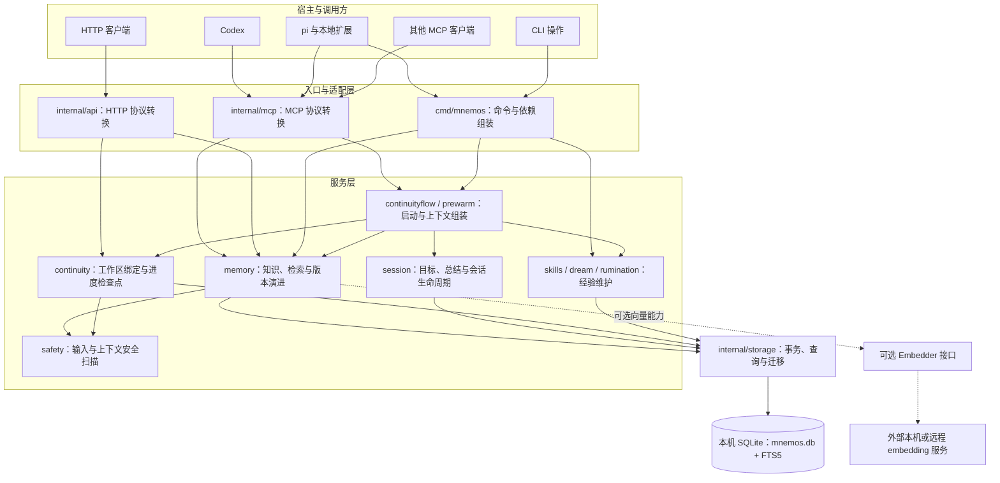
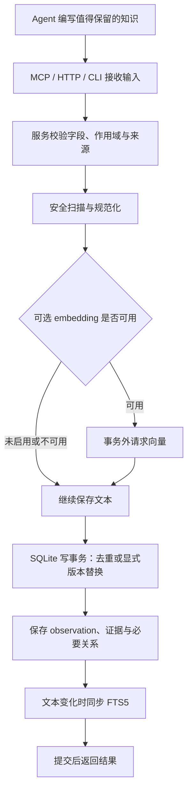
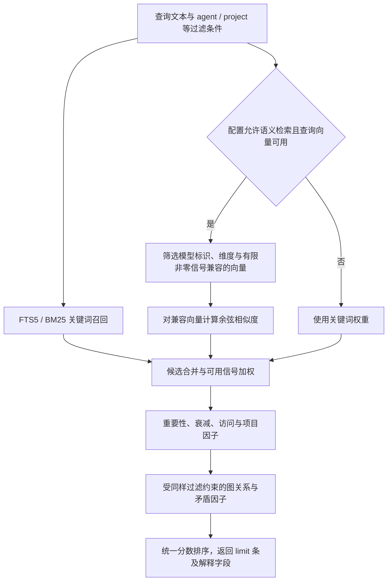
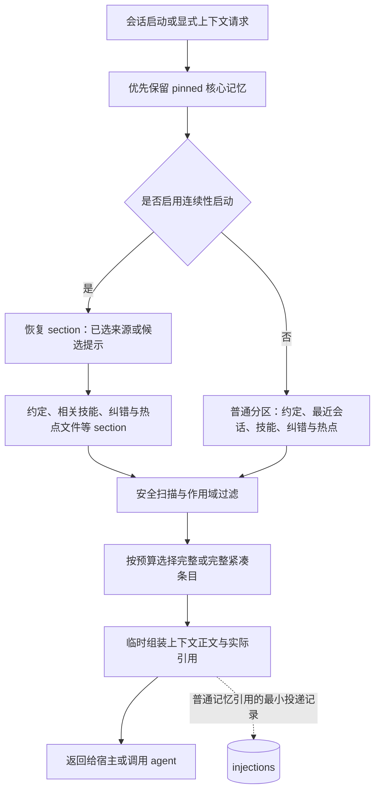
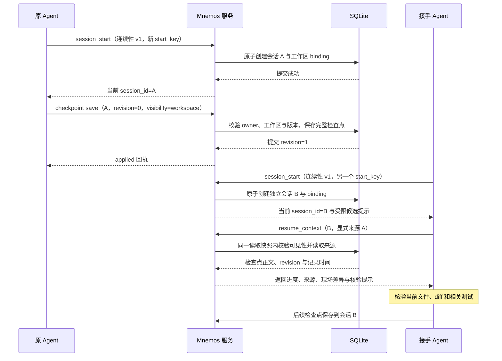
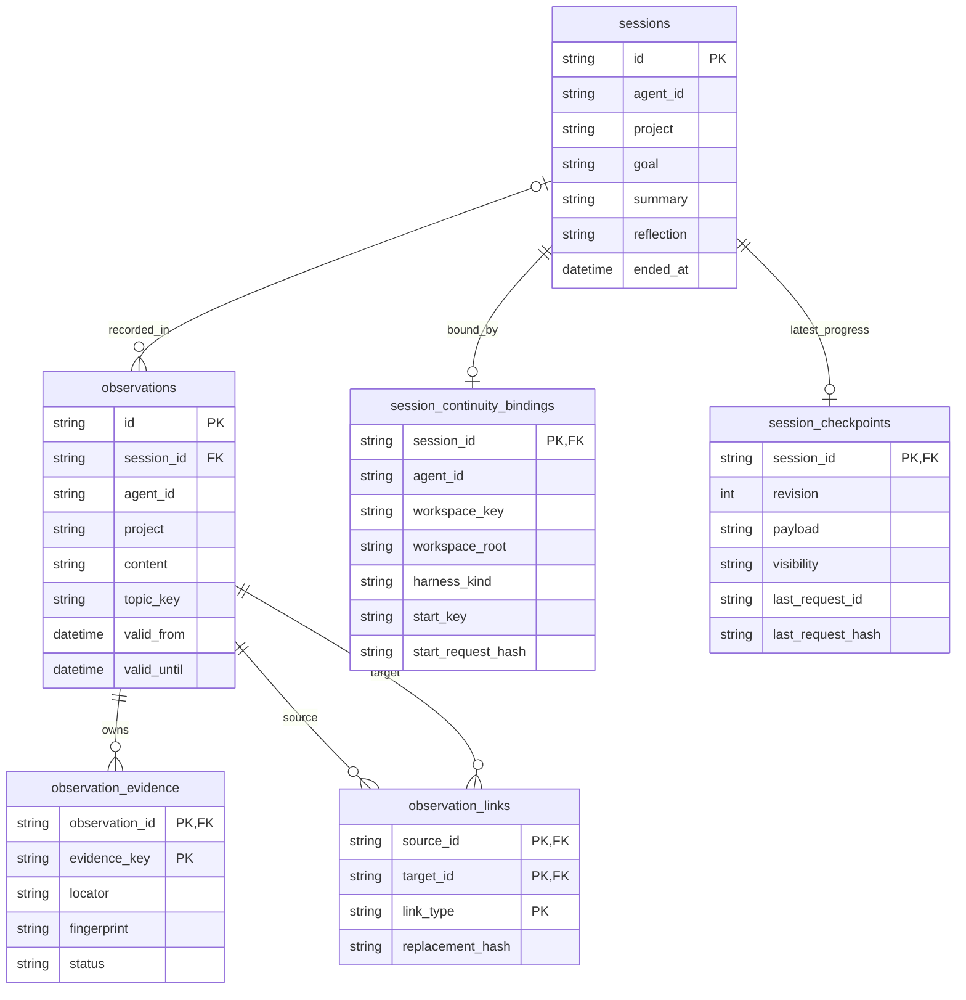

# Mnemos Memory 架构说明

本文对应 **0.15.1** 的已实现架构，核验基线为 `main@f9de93a`，整理日期为 2026-10-20。
英文主文档见 [ARCHITECTURE.md](ARCHITECTURE.md)，接口细节见 [MCP_TOOLS.md](MCP_TOOLS.md)。

Mnemos 是运行在本机的 agent 持久记忆层：把值得长期保留的知识和明确发布的任务进度保存到 SQLite，在新会话开始或显式查询时提供受预算限制的上下文。模型负责理解、总结和判断；Mnemos 负责存储、检索、作用域校验和可靠提交。

## 1. 整体分层

系统以一个无 CGO 的 Go 可执行文件交付。不同宿主可以分别启动 MCP 进程，CLI 也可以独立运行；使用同一数据库路径的进程通过 SQLite 协作。HTTP 是另一种入口。



图中合并了部分调用关系，用于解释分层，不是逐函数调用图。MCP 和 HTTP 入口只转换协议形状；业务规则由服务实现。存储接口定义在使用它的服务包，SQLite 实现通过构造函数注入。

核心约束：保持纯 Go、无 CGO；不在记忆层内调用生成式 LLM；不引入全局状态或反射装配；不把业务决策放进协议层。可选 embedding 服务会接收提交给它的记忆文本和查询文本。

## 2. 两条记忆通道

长期知识与工作进度分别建模，避免把“正在修改某文件”当成长期事实参与检索、衰减或技能晋升。

| 通道 | 典型内容 | 保存位置 | 主要读取方式 |
| --- | --- | --- | --- |
| 长期知识 | 项目约定、架构决策、纠错、经验、偏好 | `observations`、`skills` 及关联表 | 搜索、按 ID 读取、prewarm |
| 会话记录 | 本次目标、结束总结、反思、结束状态 | `sessions` | 会话查询、受限摘要恢复 |
| 工作进度 | 当前任务、已完成事项、阻塞、下一步 | `session_checkpoints`，通过 binding 绑定工作区 | 显式恢复、启动候选提示 |

检查点由 agent 主动编写，每个会话只保留最新一份正文。它不会自动生成 observation、初始化 embedding、晋升技能，或成为“任务已验证成功”的证明。

## 3. 长期记忆如何写入



来源与信任等级会限制数据可见性；原始材料 `raw` 默认隔离，不能靠重要性或 pin 绕过信任过滤。向量生成在写事务之外同步进行，provider 失败不阻止保存文本，后续可显式补齐向量。

去重使用内容身份及所属作用域。带 `topic_key`、证据引用的写入也考虑这些元数据，避免把“正文相同、主题或证据不同”的记录错误合并。

知识修订通过明确的 `replaces_id` 或 `supersedes` 关系完成：同一事务插入新版本、保存证据与替代关系、使旧版本失效。旧版本保留历史身份；同主题不表示互相替代，因此规则与例外可以同时存在。

证据只保存 locator、revision、selector、可选指纹和最新检查状态。系统不自动抓取引用正文，也不把调用方报告的 `matched` 当成独立认证。

## 4. 如何检索并排序

关键词与语义检索各自产生候选，再统一排序。向量检索不依赖先命中关键词，因此没有共同关键词的记录也可能被语义召回。



排序契约为：

```text
Score = clamp(relevance × policy × graph_factor × contradiction_factor, (0, 1.2])

policy = importance_weight × recency_factor × access_factor × cross_project_penalty
```

`relevance` 由归一化关键词与向量信号按可用权重合成；知识类型决定时间衰减速度，pin 固定时间因子但保留信任过滤。图扩展不会绕过 project、agent、类型、信任和有效时间等约束。

`hybrid_alpha` 默认 `0.5`。显式 `1` 使用关键词权重并跳过查询向量和语义召回；显式 `0` 在查询向量可用时使用纯语义权重，没有兼容向量的候选被排除。查询向量获取失败或信号无效时，即使配置为 `0` 也回退关键词。单条存量向量不兼容时不参与比较。

向量以 BLOB 保存在原 SQLite 文件中，余弦计算使用纯 Go。当前没有 ANN 索引，扫描成本随范围内向量数量和维度增加。模型通过可选接口外置提供，**当前不内置模型权重或推理运行时**。

读取可以分阶段进行：先搜索，再用 `mnemos_get_many` 获取选中的完整记录，或用 `mnemos_neighborhood` 浏览同会话的相邻摘要。批量详情默认预算 32 KiB、上限 256 KiB，完整条目放不下时返回 `omitted_for_size`，不截断事实正文。

## 5. 上下文如何交付



本图突出的是选取阶段，普通 section 的具体顺序由 composer 保持。连续性启动把恢复 section 放在 pinned 核心之后，并省略旧的最近会话 section；其余既有 section 的相对顺序保持。

预算估计统一使用 `ceil(UTF-8 字节数 / 4)`，包括标题、分隔符和警告；默认 prewarm 目标约 500 个估计 token。它不是某个模型 tokenizer 的精确计数。条目按完整、完整紧凑、最小引用等表示尝试，必要的安全和矛盾警告必须一起保留；放不下就省略。

候选集合、去重集合、紧凑片段、最终渲染正文和 `continuity_refs` 都是请求内数据，不另建表。普通 observation/skill 的最小投递记录只说明服务输出过引用，不证明宿主显示、模型采用或任务成功；continuity 来源不会冒充 observation/skill 写入该日志。

系统不在后台持续把其他会话的进度推入当前上下文。需要更新时由 agent 显式查询；宿主支持的 hook 入口及其注入通道另受宿主能力约束。

## 6. 切换 agent 后如何恢复会话

恢复共享进度时，接手 agent 打开自己的新会话，再读取来源检查点。来源会话 ID 用来定位进度，不能代替接手方的当前会话 ID。



### 6.1 同一个项目如何判定

连续性使用 `workspace_key`，由规范化的本机工作树根路径计算带版本前缀的哈希。Git 仓库根与其子目录共享身份；同名 clone、不同 worktree 默认不同。分支与 HEAD 是现场元数据，不是工作区身份。

非 Git 项目必须显式传入存在的 `workspace_root`，且根必须包含调用目录。不能用末级目录名猜测。旧的 observation `project` 标签仍按原契约工作，新增工作区身份不会重写旧记录或消除所有旧标签碰撞。

### 6.2 什么时候允许自动选来源

只有明确 `resume_intent=true`，且完整可见、经 task 精确过滤的候选集合恰好一项时，才继续检查自动恢复条件：它必须是 24 小时内的 `active` 或 `blocked` 检查点，分支和 HEAD 已知且与当前现场一致。

第二条 stale、done、异分支或摘要候选也会阻止自动选择。候选显示默认 5 项、最多 20 项，但唯一性判断不能先按显示条数截断。“最新一条”不具有自动接手权。显式选择旧来源可以返回对应警告，仍需检查当前代码；相同 HEAD 也不能证明未提交改动相同。

### 6.3 共享与可靠提交边界

owner 取 `agent_id`，默认 `default`，与 Codex/pi 等宿主名字分开。不同宿主都使用 `default` 时属于同一 owner 命名空间；这不是抵御能直接访问本机数据库进程的安全隔离。

检查点默认 `visibility=owner`，显式 `workspace` 才向同工作区其他 owner 发布该份正文。共享不会开放来源会话的私有目标、反思、其他观察或引用文件，也不会转移所有权。恢复不领取、不消费来源，多个会话可读取同一份进度。

更新使用 `expected_revision` 和稳定 `request_id`。当前请求精确重试返回原 `replayed` 回执；过期请求不能覆盖新版本。清除保留无正文的版本标记，阻止旧请求复活正文或回退到结束摘要。超时表示结果未知，应按原请求核验。检查点 `state=done` 与 session_end 是两件事。

恢复的是 agent 编写的工作状态与定位线索，不恢复完整对话、模型内部状态、终端进程或尚未保存的操作。每个会话只保留最新检查点，没有检查点历史或领取状态。

## 7. 哪些数据需要落库

持久化的判断标准是：它是否构成跨会话可复用事实、明确进度，或保证重试、版本和来源正确性所必需的状态。可重算的请求中间结果保留在内存中。

| 数据 | 是否落库 | 设计理由 |
| --- | --- | --- |
| 知识正文、类型、重要性、信任与生命周期 | 是 | 长期记忆的主体 |
| 主题、版本替代与关系边 | 是 | 保留规则/例外和显式修订链 |
| 证据定位、可选指纹、最新检查状态 | 是 | 说明来源及最近一次调用方核验 |
| 可选 embedding 向量与模型标识 | 是 | 避免每次重算，校验检索兼容性 |
| 会话目标、总结、反思、结束状态 | 是 | 保留工作记录，不在共享恢复时全部开放 |
| 工作区 binding 与启动重试身份 | 是 | 确认当前会话，避免超时后串会话 |
| 最新检查点、revision、当前请求标识/哈希 | 是 | 恢复进度与防止重复、过期写入 |
| 清除后的无正文版本标记 | 是 | 阻止旧请求与旧摘要复活 |
| 技能、使用计数、效果与纠错维护状态 | 是 | 支持经验维护与确定性晋升 |
| 热点文件触碰、最小投递引用 | 是 | 支持热点与输出来源统计，不保存文件正文 |
| FTS 索引 | 是，派生结构 | 加速关键词检索，由事务触发器维护 |
| 检索候选、排序分数、恢复候选列表 | 否 | 随查询、过滤和现场变化，可重新计算 |
| prompt 的有限目标片段 | 条件性落库 | 既有 prompt hook 可把首个非 synthetic 用户 prompt 折叠空白并有限截短后补入空 `sessions.goal`；pi 也可经过此路径 |
| 完整 transcript、prompt 和工具输出原文的持续镜像 | 否 | 上述有限目标采集不等于保存完整对话；知识和检查点仍由 agent 明确编写和选择 |
| 上下文渲染块、紧凑片段、预算与去重集合 | 否 | 只服务当前请求，不重复保存知识 |
| 源 URL 或文件正文的自动镜像 | 否 | 引用只保存定位信息，不自动抓取 |
| embedding 回填游标与失败摘要 | 否 | 单次维护过程状态，下次可重新扫描 |
| 接手人、领取锁、消费确认 | 否 | 当前设计提供共享读取，不做调度与互斥领取 |

### 7.1 主要实体关系



此图省略技能、统计、索引及部分字段。每个 session 可以没有 binding 或 checkpoint；每个 observation 也可以不属于某个 session。关系、证据与检查点保存在原 SQLite 文件中，不引入额外数据库。

## 8. SQLite 并发、维护与备份

数据库使用 WAL、外键和 busy timeout，迁移通过内嵌编号 SQL 与 `schema_migrations` 管理，当前迁移到 **10**。跨进程升级时，取得立即写事务后重新检查版本，再执行 DDL 和写入迁移标记，防止多个进程重复升级。

首次 WAL 连接初始化的 Ping 阶段只对类型明确的 SQLite BUSY 错误进行有限重试；业务写入与迁移 SQL 不因此得到通用自动重试。驱动连接本身还受 busy timeout 影响，不能把应用层重试窗口当成绝对墙钟超时承诺。

迁移 0010 使 FTS 更新只在索引文本字段实际变化时执行。访问计数、信任、生命周期或效果统计变化不重建文本索引。

恢复候选在同一读取快照中扫描全部可见元数据以统计歧义，只保留 top-K 窗口，再读取这 K 条完整正文；元数据扫描成本仍随历史增长。该优化不会删除历史，也不改变唯一性判断。

embedding 回填使用有限 ID 高水位和每页 100 条的 keyset 游标，失败也推进游标。默认补缺，`--rebuild-incompatible` 显式重建不兼容模型/维度；部分失败返回非零状态，已成功更新保留，不另建持久作业表。

普通知识采用事实时间与系统时间字段，默认查询当前有效内容，可显式查询历史。`AsOf` 不是所有可变元数据的完整历史快照。pin 保留时间权重并避免 TTL 清理，但不代表绝对不可删除。

知识导出支持主题、证据与修订关系；continuity 状态不在既有逻辑导出的完整范围内。同机完整连续性备份应使用一致 SQLite 备份。清除检查点是逻辑清除，不保证删除 WAL 或已有备份中的旧正文。详见 [BACKUP.md](BACKUP.md)。

## 9. 技能、巩固与反思

技能可由 agent 主动编写，也可由 dream 进行确定性纠错聚类晋升。相同 `(agent_id, project, label)` 的 3 条及以上 live correction 可以生成模板技能，使用 `promoted-origin:<12位哈希>` 标记保持幂等。

dream 顺序为：清理过期记忆 → 衰减闲置重要性 → 晋升技能 → 在发生变化时记录 journal。rumination 保存被质疑的候选及处理理由，修订理由需要给出新方案能作出的新预测。这些流程不在记忆层调用生成式模型。

## 10. Codex 与 pi 接入

| 项目 | Codex | pi |
| --- | --- | --- |
| 工具入口 | MCP server 配置启动 `mnemos serve` | 本地 package 经 MCP adapter 暴露工具 |
| 生命周期 | 仅配置 MCP 不代表有自动启动 hook；agent 按 skill 显式调用 | 扩展处理启动、reload、new、resume、fork 等事件 |
| 连续性开启 | 显式调用带 `continuity` 的 v1 session_start | 自动路径需 `MNEMOS_CONTINUITY=1` |
| 非 Git 根目录 | 显式传 `workspace_root` | 可显式调用 API；自动扩展目前无该根目录配置，显式会话也不会绑定其自动 hooks |
| 上下文交付 | 工具返回由 agent 使用，取决于宿主接入 | 启动块通过 `before_agent_start` 的 `systemPrompt` 交付 |
| 扩展更新 | 新 MCP 进程加载新二进制 | 复制 package 到 pi 用户目录后 reload；本地目录包不由 `pi update` 下载更新 |

当前本机 pi 副本位于 `~/.pi/agent/local-packages/mnemos`，是独立目录，运行时不从开发仓库加载。其 `mcp.json` 指向 `D:/software/mnemos/mnemos.exe`。更新副本时保留用户注册、MCP 的绝对程序路径及非本项目管理字段。

pi 的 `tool_call` 是阻断/放行通道，不支持通过返回 system prompt 注入记忆。自动连续性启动结果未知时，扩展保持未绑定状态，不猜测其他 session；安全 guardrail 仍执行，依赖 session 的自动事件暂不发送，不排队补放。

MCP 提供 23 个核心工具、4 个可选 rumination 工具，以及 4 个只读资源。只有开启 rumination 时才是 27 个工具。磁盘二进制替换后，已有 MCP 进程仍可能运行旧程序；启用连续性前，应重启同一数据库的所有旧宿主进程。

当前安装构建 `0.15.1+f9de93a` 已分别通过真实 Codex app-server 19 次直接 MCP 调用、pi SDK/adapter 12 次直接工具调用，以及隔离注册的 `pi update --extensions`。这些验证不调用模型，不能推导出模型实际采纳率或 TUI 行为效果。记录见 [本轮验收](../openspec/changes/archive/2026-10-20-harden-local-memory-runtime/verification.md)。

## 11. 阅读入口

| 需要了解的内容 | 文档 |
| --- | --- |
| 英文架构与完整评分公式 | [ARCHITECTURE.md](ARCHITECTURE.md) |
| MCP 输入、回执、限制与错误 | [MCP_TOOLS.md](MCP_TOOLS.md) |
| 上下文预算与投递来源 | [CONTEXT_PROTOCOL.md](CONTEXT_PROTOCOL.md) |
| 向量 provider、兼容性与维护 | [EMBEDDINGS.md](EMBEDDINGS.md) |
| 共享进度的设计取舍 | [共享会话连续性设计](../openspec/changes/archive/2026-10-19-add-shared-session-continuity/design.md) |
| 并发升级、检索及读取优化 | [运行时加固设计](../openspec/changes/archive/2026-10-20-harden-local-memory-runtime/design.md) |

内置向量模型仍属于后续规划，不在当前已实现架构内。跨机器同步、完整对话回放、单一接手人领取锁、后台持续注入和多租户 ACL 也不属于本文所述能力。
