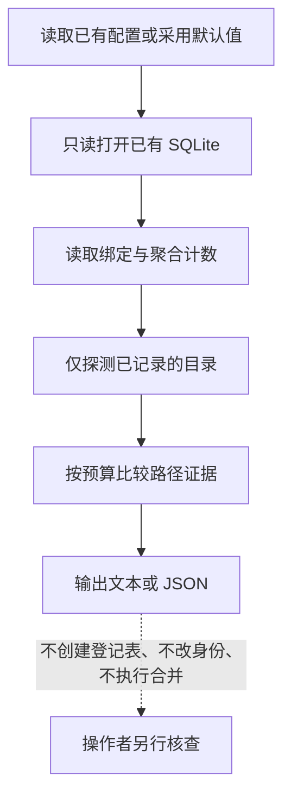

# 工作区身份诊断

`mnemos doctor --workspaces` 汇总现有 continuity 绑定，帮助检查历史会话是否分散在重复路径、父子目录或疑似迁移路径下。它只给出核查线索；报告中的任何结果都不表示可以安全合并。

## 使用方式

运行 `mnemos doctor --workspaces` 查看人类可读报告；添加 `--json` 可输出适合脚本处理的 JSON。该模式会在一般 `doctor` 的存储初始化之前分流。普通 `mnemos doctor` 仍执行完整安装与存储检查。

诊断使用选中的 TOML 配置中的 `storage.path` 与 `[diagnostics.workspaces]` 预算。隐式默认配置文件不存在时使用内置默认值，不创建配置文件；若通过 `--config` 显式选择的文件不存在或无效，命令会报错。`max_roots` 控制读取和探测的绑定数量，`max_candidates` 限制报告中的候选数，`timeout` 限制一次诊断的时间。默认值分别为 1000 个根、200 个候选和 10 秒。服务会在超时前比较所有已加载根的组合；候选数达到上限后，仅在发现额外候选时标记结果不完整。

## 报告内容

每个身份由记录的 `workspace_root` 与 `workspace_key` 组成。根路径相同不代表历史会话身份相同，因此报告始终同时显示两者。

计数只聚合 continuity 元数据：绑定会话数、仍打开的会话数、检查点数、清除标记数，以及 owner/workspace 可见性下的检查点数。检查点正文、会话 goal、私有摘要、来源文本、凭据以及启动重试 key/hash 不会被读取或输出。重试冲突只显示重叠次数，不暴露用来计算冲突的值。

本地探测只检查数据库里已记录的根目录及其本地 Git 元数据，不递归扫描源码，不联系网络、模型或仓库注册服务，也不读取分支名、HEAD 或远端。路径无法访问、Git 元数据无法判定或执行预算耗尽时，证据保持未知。

## 分类含义

| 分类 | 报告所依据的证据 | 应如何理解 |
| --- | --- | --- |
| `verified_path_equivalence` | 两个现存根经文件系统身份检查指向同一物理目录 | 当前路径别名已验证；历史绑定、重试、可见性和会话身份仍需人工核查 |
| `possible_boundary_split` | 两个现存非 Git 根呈父子目录关系 | 可能是一个项目被不同根记录，也可能是独立模块或嵌套项目 |
| `possible_migration` | 一个相似命名的历史根已缺失，另一个根当前存在 | 仅表示可能迁移；不证明内容或身份连续 |
| `independent_git_roots` | 相似或嵌套路径落在独立 Git 根中，或记录路径位于同一 Git 工作树 | clone、worktree 或项目边界默认保持独立；相同 Git 元数据不构成合并证据 |
| `unknown_evidence` | 路径或必要元数据不可访问、无法判定 | 不能将未能检查解释为没有冲突 |
| `weak_similarity` | 只匹配到路径拼写或身份字段的弱相似 | 线索较弱，需要结合项目实际边界核查 |

输出中的 `merge_safety` 固定为 `not_established`。`consolidation_candidate` 只表示值得人工查看的候选。活动会话、孤立绑定、重叠重试身份、checkpoint 可见性，以及工作区 scope 的变化会作为风险或阻碍项显示。任何操作都不会迁移、重绑或合并记录。

## 部分结果与限制

`status=partial` 表示报告没有覆盖全部根或比较。`incomplete_reasons` 会列出根数、候选数、重试冲突或时间预算的耗尽，以及路径元数据不可用等原因。JSON 中的 `possible_pairs` 是理论总对数，`compared_pairs` 是实际完成的比较数；未比较的组合仍未知。候选上限不会截断前若干路径比较；服务会继续检查已加载根的所有组合，直到完成或总时间预算耗尽，因此靠后的别名仍有机会被发现。

`status=no_history` 只用于数据库文件不存在；已有数据库但没有 continuity binding 时返回 `status=ok` 和空报告。旧 schema 或缺少诊断所需表/字段会明确报错；诊断不会运行迁移来修复它们。诊断自身不会创建数据库或父目录，不切换 journal mode，也不增加会话、记忆或访问计数。WAL 模式下，必须已经存在可读的 `-wal` 和 `-shm` 文件；缺少任一文件会明确报告只读限制，避免 SQLite 创建源 sidecar。SQLite 可能短暂更新现有 `-shm` 中的 reader mark；诊断自身保持主数据库和 WAL 字节、目录项、sidecar 存在状态和大小，以及业务计数不变。与任意在线读取一样，其他并发写入者可能改变这些文件；完整性测试隔离诊断造成的变化，不保证并发写入时哈希恒定。

路径探测、SQLite 文件系统及并发连接行为受操作系统和 SQLite 状态影响。若命令明确报告忙、锁定或证据不可访问，应在数据库没有并发写入时重试；不要把不完整报告视作全量核验。
